# Shader zone preview — validation record

Issue: https://github.com/UpperMoon0/Simply-Speakers/issues/24

This is an implementation and acceptance work log for a draft PR. It is not a
performance improvement claim. The original particle preview is the comparison
baseline at `fc75a98`.

## Design

Speaker-local immutable ribbon geometry has 640 segments for omnidirectional
speakers and 645 for directional speakers, independent of range. The custom
vertex shader extrudes segments in screen space. Cyan denotes the three maximum
range hoops; gain-colored inner rings use the playback attenuation function;
white lines denote the forward arrow and cone edges. Visible geometry is solid;
terrain-hidden geometry is faint and dashed. Neither pass writes depth.

The GPU buffer is uploaded once per preview; camera-relative translation is
computed in double precision before conversion to shader uniforms. Motion updates
translation/rotation, not the buffer. The existing 30-second lifetime and HUD are
retained. The 1.21.1 Sable resolver remains the source of transformed speaker poses.

## Acceptance status

- Baseline core Gradle suite: passed locally with JDK 21.
- New mesh tests: passed with the existing core suite.
- 1.20.1/1.21.1 adapters and derived legacy/26.x adapters: implemented; native
  build and runtime checks are in progress.
- Requested-generation source suite: 23 tests passed (`python -X utf8`).
- Native 26.1.2 build and GPU cleanup/fallback tests passed. All three version
  adapter suites passed; the additional Sable portable interpolation test passed.
- Fabric 1.20.1 and 1.21.1, Forge 1.20.1 and NeoForge 26.1.2 built locally.
- Actual hidden Minecraft captures and paired particle/shader timings: collected
  on Fabric 1.20.1. See the measured results below.
- Shaderpack and mod compatibility: not verified in a game runtime.

No synthetic image or source-only timing is presented as Minecraft acceptance.

## Hidden-window graphics fixture

`tools/zone_shader_smoke.py` compiles the actual OpenGL renderer and creates an
invisible GLFW window. On this machine it reported NVIDIA GeForce GTX 1050 Ti,
OpenGL 3.3.0, NVIDIA 581.15. It passed program compilation, actual draw output,
restoration of non-default GL state, resource deletion, reload, and forced fallback.

Eight actual GPU captures were inspected: small outside/inside, large
outside/inside, two moving-origin/direction poses, and controlled depth occlusion.
These are **shader-fixture captures, not Minecraft screenshots**. The depth case
uses a controlled scissored depth buffer, not Minecraft terrain. The portable cases
exercise uniform changes, not Minecraft's holder tracking or Sable integration.
They establish shader output and state/resource behavior, not game acceptance or
particle-baseline performance.

The short-far-plane capture is pixel-identical to the long-far-plane fixture.
This checks that diagnostic range boundaries remain readable beyond the terrain
far plane while retaining depth tests and without requesting chunks.

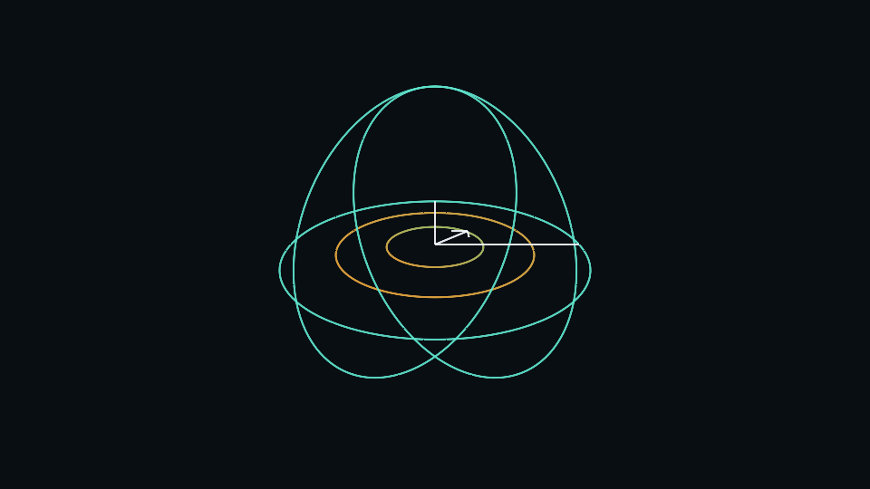
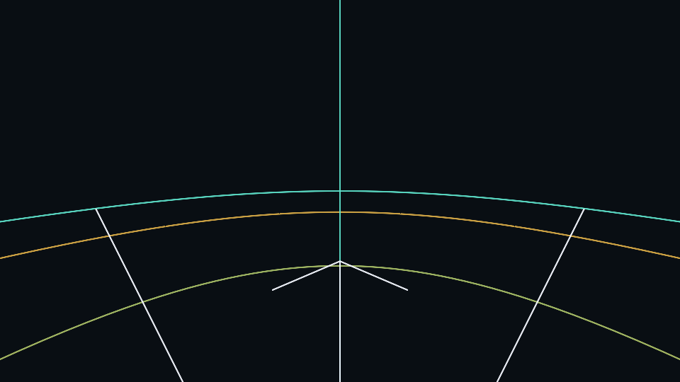
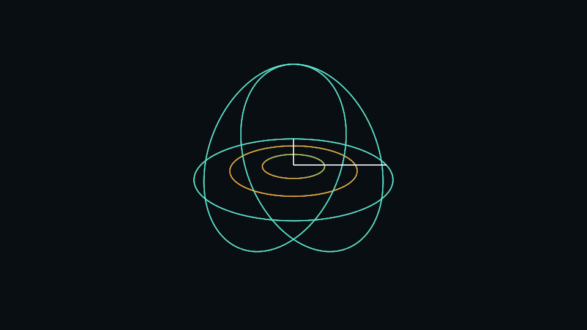
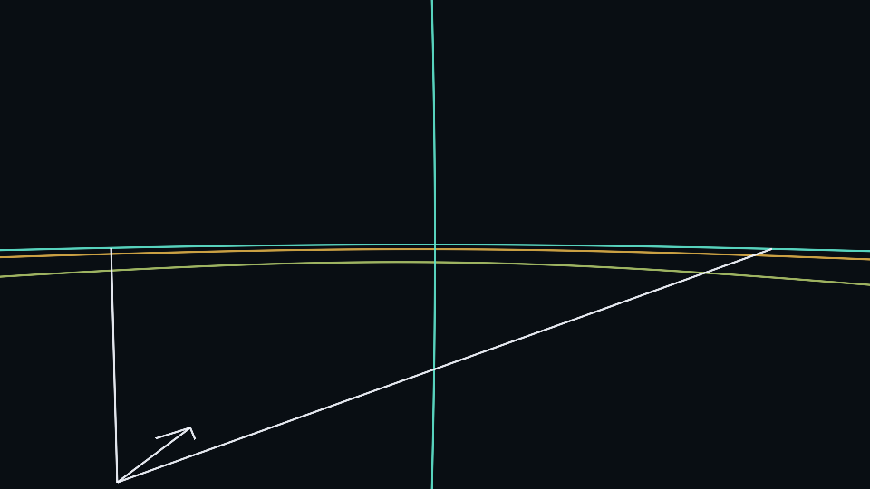
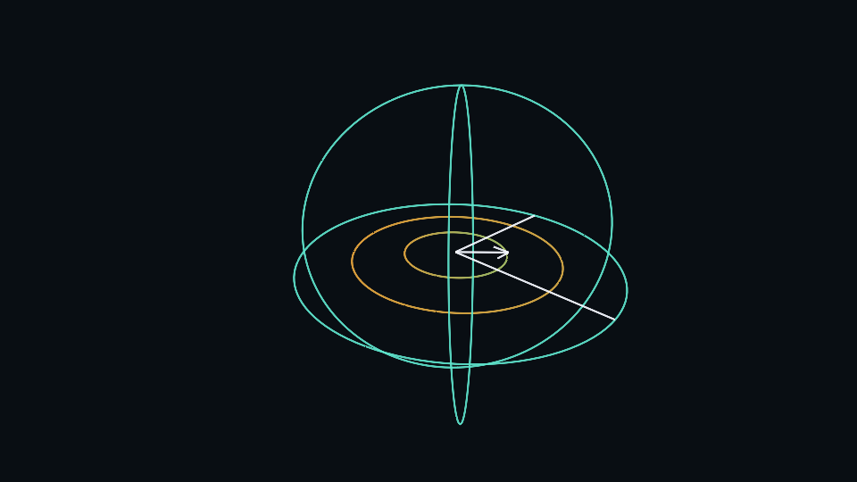
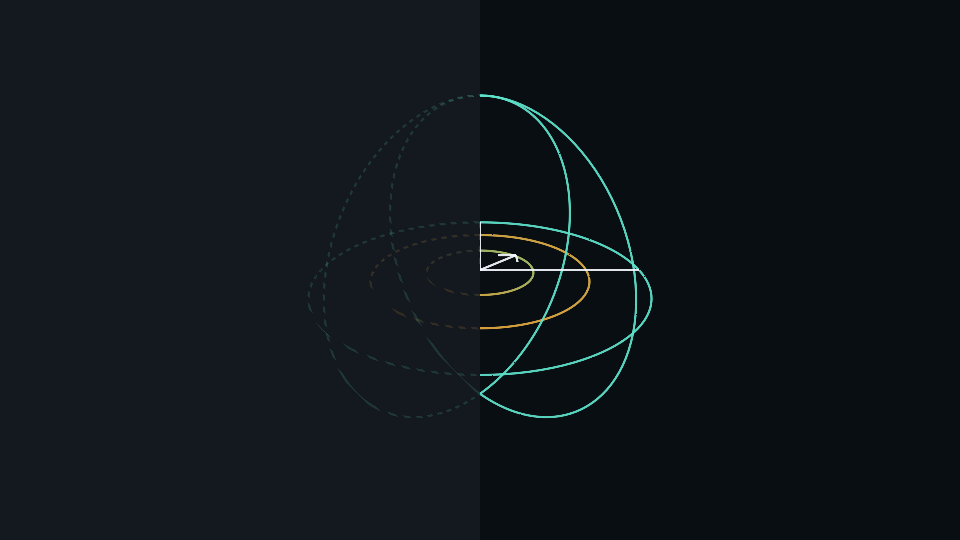

## Actual Minecraft comparison

The final paired run used **actual Minecraft 1.20.1/Fabric**, Java 17, an invisible
960x540 window, eight-chunk view distance, VSync off, the same superflat server
seed, fixed camera poses/settings, 100 warm-up ticks and 300 samples per scene.
NVIDIA GTX 1050 Ti, driver 581.15, OpenGL 3.2.0. The comparison worktree retains
the original `fc75a98` preview and geometry byte-for-byte after line-ending
normalization; only identical test instrumentation was added.

CPU measurements cover `GameRenderer.render` submission including HUD; GPU
measurements use `GL_TIME_ELAPSED` over the same renderer scope. Frame intervals
include the surrounding game frame. These are whole-scene measurements, not
preview-exclusive GPU timings. The first zero frame interval is discarded.

| Scene | CPU particle / shader (ms) | CPU change | GPU particle / shader (ms) | Frame particle / shader (ms) |
| --- | --- | --- | --- | --- |
| small outside | 5.936 / 5.035 | -15.2% | 2.293 / 2.235 | 8.717 / 7.545 |
| small inside | 5.697 / 4.871 | -14.5% | 2.041 / 2.300 | 8.381 / 7.347 |
| large outside | 5.622 / 4.357 | -22.5% | 2.032 / 2.089 | 7.707 / 6.329 |
| large inside | 5.675 / 4.729 | -16.7% | 2.133 / 2.074 | 8.251 / 7.146 |
| moving portable | 5.808 / 4.735 | -18.5% | 2.187 / 2.634 | 9.779 / 8.641 |
| terrain | 5.546 / 5.262 | -5.1% | 2.245 / 2.633 | 9.348 / 9.386 |

Values are medians. [Raw samples, p95 summaries, source hashes and settings](validation/zone-preview/game/metadata.json)
and [the timing summary](validation/zone-preview/game/summary.json) are retained.
Median CPU submission improved in this run; **GPU time and p95 did not improve
uniformly**. Terrain median frame time was effectively unchanged/slightly worse.
This is one paired run on a working machine with uncontrolled host load, with
shader first and particles second. It does not certify a general GPU/p95 speedup
or performance on other versions/backends. Performance acceptance remains partial.

The camera is detached from the listener to inspect the zone from inside and
outside without loading distant chunks. The HUD correctly continues to report the
actual player's distance, so it can say "inside" while the camera is outside.
The moving case exercises the actual portable-token/holder preview path. Large
outside boundaries extend beyond the terrain far plane; the original particles
can be clipped there, so the visible work differs even with identical settings.

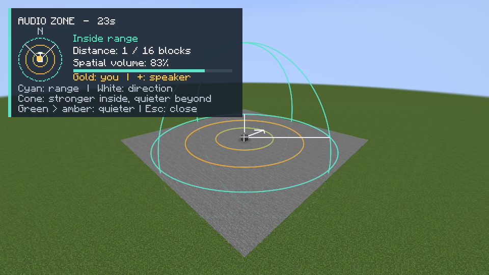
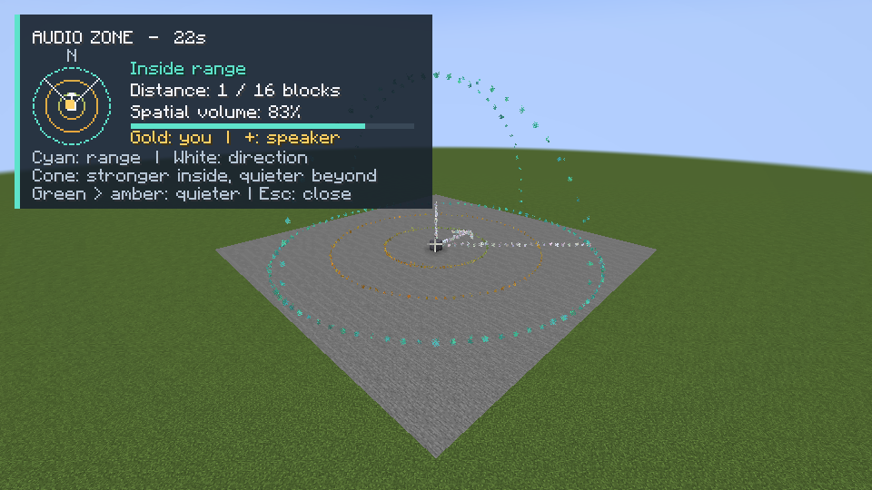
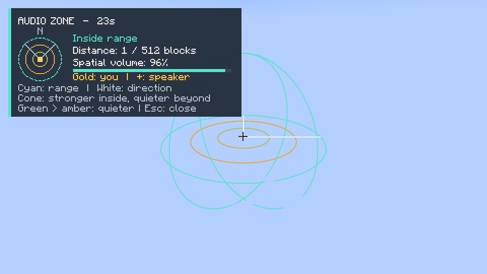
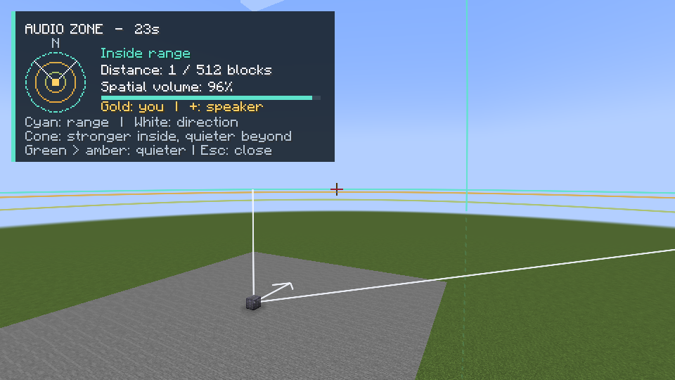
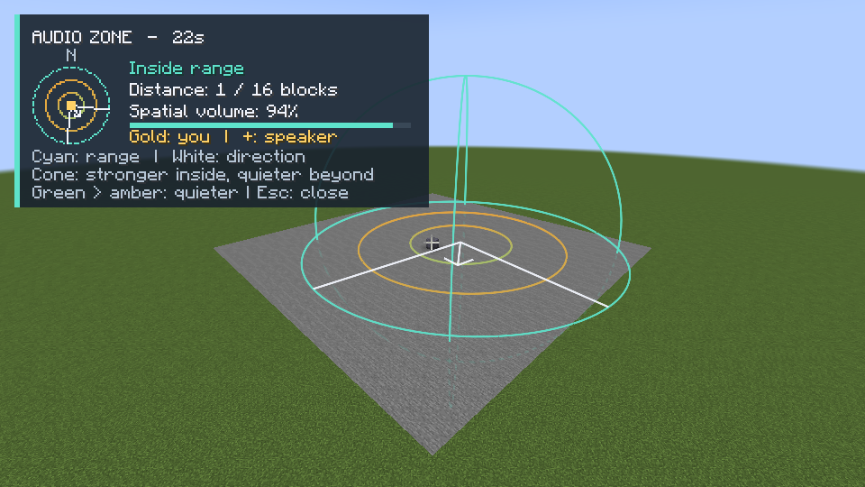
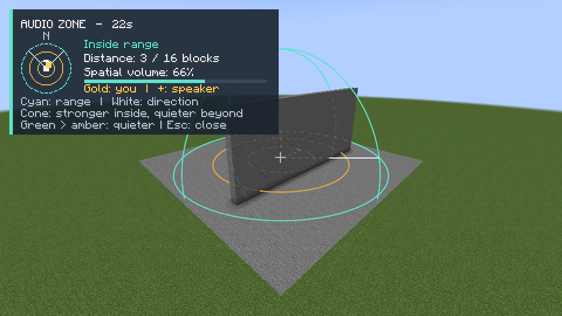
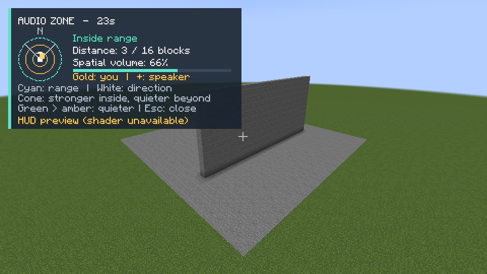

All thirteen game captures were inspected. Camera head rotation and far-plane
visibility were corrected after the initial inspection; the retained comparison
uses the corrected fixture. Both client processes completed their scene markers
and screenshot/sample checks, then the isolated server stopped and saved cleanly.

Reproduce after building the pinned dependencies:

```text
python tools/prepare_zone_baseline.py --output ../particle-baseline
python tools/zone_runtime_test.py --baseline ../particle-baseline --java-home <JDK21>
```

The tool uses private development directories and localhost port 25586. It never
controls another application or captures the desktop. Its server profile accepts
the Minecraft EULA for that isolated test world, as the existing live harness does.

## Required measurement protocol

Use separate clean game profiles from the baseline and PR head, with identical
game/loader, JVM, window size, world seed, camera poses, view distance, graphics,
and speaker settings. Warm up each scene, measure preview-off and preview-on
frame durations, and report median/p95 plus hardware, sample count and GPU/CPU
timing method. Do not compare an idle scene to an active scene. Preserve both
raw frame samples and screenshots. Include a moving portable speaker and a
stationary camera; repeat with small and maximum ranges, inside/outside views,
terrain crossings, resource reload, disconnect, and HUD-only fallback.

## Repeated performance investigation

A second experiment used shader / particles / particles / shader order, 100 warmup
ticks and 600 samples per scene. All four processes completed, producing 26 PNGs
and 15,600 raw whole-frame CPU/GPU samples. The original paired experiment above
is retained unchanged. [Every run and percentile](validation/zone-preview/repeated/comparison.md),
[raw data and provenance](validation/zone-preview/repeated/metadata.json) are committed.
The failed first attempt (fixture static initialization, no samples collected) is
also retained, followed by the corrected run.

The additional instrumentation brackets the shader render method or the entire
particle engine in the empty fixture. Median preview CPU submission cost was
0.025–0.034 ms for shaders versus 1.044–1.196 ms for particles. This is a measured
reduction in this fixture, not a universal frame-rate claim. GPU timestamps measure
submission spans including pipeline idle time; they do not isolate GPU busy time.

Whole-scene GPU and p95 differences are not consistently reproduced across order.
For example, large-outside shader/particle GPU medians were 2.088/1.876 ms in the
first pair but 1.799/1.838 ms in the reversed pair. Shader preview spans in that
scene were 0.007 and 0.003 ms versus particle spans of 0.010 and 0.019 ms. Terrain
whole GPU medians were 2.657/2.391 and 2.425/2.420 ms, with shader preview spans
0.032/0.031 ms and particle spans 0.053/0.052 ms. This evidence points to substantial
whole-scene/host variation; it does not establish a repeatable material preview
GPU regression to optimize. Two repetitions and uncontrolled clocks/scheduling
cannot prove GPU equivalence. GPU/p95 acceptance remains limited, and all slower
shader results remain in the report. No production geometry was removed to improve
a benchmark score. The 512-block shader also displays boundaries beyond the terrain
far plane where the baseline has no visible particles, so useful visible work differs.

The final repeated small/large, inside/outside, portable, terrain and fallback
captures were inspected. Thin cyan range hoops, white direction and colored gain
rings remain legible; hidden terrain guides are faint dashed lines. The HUD listener
continues to be separate from the detached inspection camera as described above.

Reproduce the repeated experiment:

```text
python tools/prepare_zone_baseline.py --output ../particle-baseline --refresh-fixture
python tools/zone_runtime_test.py --baseline ../particle-baseline --java-home <JDK21> --order shader,particles,particles,shader --samples 600 --output build/zone-repeat
python tools/zone_runtime_report.py build/zone-repeat
```

## Additional version visual evidence

[NeoForge 26.2 screenshot](validation/zone-preview/ports/neoforge-26.2-ci.png) comes
from the passing native CI fixture at `7737019` (provenance beside the image).
It was viewed: the HUD and colored zone bands are present. Its camera is close to
the speaker inside the volume, so it is narrower coverage than the seven-scene
1.20.1 fixture. This is not a Vulkan or shaderpack qualification.

## Actual shaderpack qualification

Fabric 1.20.1 + Iris 1.7.6 + its required Sodium 0.5.12-beta.2 + Complementary
Reimagined r5.9.3 passed the hidden real-game fallback fixture on the same GTX 1050 Ti.
The probe required a nonempty Iris pack and an active `IrisRenderingPipeline`,
`hidden=true`, `forcedHudOnly=false`, active HUD and zero submitted zone geometry.
The [actual screenshot](validation/zone-preview/shaderpack/qualified/01-compatibility/compatibility-fallback.png)
was viewed: the shaderpack scene and labeled HUD render normally, with no zone
ribbons. Full logs, publisher metadata, versions and SHA-512s are in the
[qualification evidence](validation/zone-preview/shaderpack).

Two failed attempts are retained: the old hidden-window redirect conflicted with
Sodium's own creation redirect; it was replaced with an injection after GLFW resets
its hints, leaving Sodium's driver workaround intact. The next attempt lacked
Iris's bundled JCPP runtime in the development classpath. The final run explicitly
loaded the verified jar's nested JCPP/ANTLR/GLSL-transformer libraries. Nothing was
removed from Iris, Sodium, or the shaderpack. Iris emitted warnings for newer biome
names/block IDs, which remain in the log; its shader pipeline stayed active and
the scene rendered successfully. No external mod binaries are committed.

Reproduce with the files named and hashed in `shaderpack/files.json`, extracting
Iris's bundled JCPP/ANTLR/GLSL-transformer jars for Loom's development runtime:

```text
python tools/zone_runtime_test.py --java-home <JDK21> --order compatibility --output build/zone-iris --graphics-mod <iris.jar> --graphics-mod <sodium.jar> --graphics-mod <jcpp.jar> --graphics-mod <antlr.jar> --graphics-mod <glsl-transformer.jar> --shaderpack <Complementary.zip>
```

This qualifies the conservative HUD-only compatibility path for this exact stack.
It does not qualify ribbons inside Iris, other shaderpacks/versions, OptiFine, or
Vulkan. Those require their version-matched runtime dependencies and an equivalent
active-pipeline capture fixture; no such results are claimed here.

## CI findings during follow-up

The Forge 1.16.5 adapter needed native matrix/pose/camera/renderer type mappings;
these are corrected and covered by the generation suite. The CI JDK producer's
`21.0.13+9` output could not be resolved on a fresh setup-java runner whose catalog
uses `21.0.13+9.0.LTS`. Consumers now select the producer's observed patch, then the
existing provenance validator still requires the exact runtime build, vendor,
architecture and artifact hashes. A regression test rejects a different build.
The 42 changed cache/workflow/generation tests passed on Linux.

At `7040b75`, Fabric 1.16.5 built and its independent ordinary Singleplayer menu
acceptance passed. Its dedicated/two-client check failed because native Minecraft
reported `multiplayerAllowed=false` after loading. No eligibility override was
attempted. That acceptance requires a launch profile for which native Minecraft
reports multiplayer eligibility. This is distinct from a renderer compilation or
shader failure. Final-head CI status must still be checked separately.

Forge 1.16.5 at `7040b75` failed before compiling this mod: the pinned OpenUI
standalone build could not resolve `net.minecraftforge:binarypatcher:1.0.12`
(`no repositories are defined` in ForgeGradle's downloader configuration), then
could not produce `forge:1.16.5-36.2.42_mapped_official_1.16.5`. This requires the
pinned dependency build's ForgeGradle repository/mapping resolution to succeed;
it is not a newly observed renderer source error. No pinned dependency sources
or runtime eligibility assertions were changed to bypass these failures.

## Narrow ForgeGradle downloader correction

A controlled ForgeGradle 6.0.54 / Gradle 8.8 probe reproduced the exact empty
fallback failure, then succeeded with the consumer's init script. ForgeGradle
already adds its Maven endpoint, but its last fallback only accepts non-Maven
repositories. The init script adds an Ivy artifact view of the same official
`https://maven.minecraftforge.net/` endpoint, restricted to
`net.minecraftforge:binarypatcher:1.0.12`. It does not change pinned dependency
sources, tool versions, TLS or authentication. `build_requested_release.py`
passes it to the two pinned dependency builds and consumer only for Forge 1.16.5.

The resolved fatjar was 3,809,410 bytes, SHA-256
`16454ff27db627d408d58d267e64fc9c48bcf9f691a71c2e65bbd65a61f0a627`.
An independent download from the publisher's canonical HTTPS artifact URL matched.
The publisher's `.sha256` sidecar was unavailable (404), so that is not claimed as
the checksum source. The probe uses a private ForgeGradle downloader cache, forces
the manual-Maven miss for its control, tests the actual init script, and checks
that successful resolution restores the repository list. Its expected control
stack trace is retained in [the log](validation/zone-preview/forge-downloader.log).
This proves the narrow fallback mechanism; final native compilation/runtime CI
is required separately. The native multiplayer eligibility gate is unchanged.

```text
bash forge-1.16.5/gradlew -p tools/fixtures/forge-1165-downloader --init-script <absolute-repo>/tools/forge_1165_repositories.gradle probeDownloader --no-daemon --max-workers=2
```

The next layered CI exposed Temurin hotfix `21.0.12.1`: setup-java does not accept
four numeric version segments. The selector now asks Adoptium's official release
metadata for the exact observed `JAVA_RUNTIME_VERSION`, and passes its published
SemVer (for example `21.0.12.1+1-LTS` maps to `21.0.12+101.0.LTS`). An identified
JSON request is required by that API. Missing or ambiguous exact matches fail
closed; full consumer runtime/build/vendor/architecture validation is retained.
The real installed hotfix resolved to the expected published value locally.
Standard/hotfix/missing-version tests pass, including rejection of another runtime
build. The 45 changed cache/workflow/generation/build-routing tests passed in Linux.

A later Forge 1.20.1 runtime found that its older Mixin rejects constructor
`@Inject` at an invocation. The capture hook now redirects GLFW's default-hints
call (leaving Sodium's window-creation hook intact), and an opt-in mixin plugin
excludes all capture/timing hooks from ordinary clients. A regression test passed
for all four verification hooks and the retained production render/reload hooks.
The replacement hook booted Iris locally; that follow-up attempt disconnected
from the private server before a new capture, so no replacement capture is claimed.
The original successful shaderpack evidence remains unchanged. Test-only early
window/connection diagnostics now fail promptly instead of idling after disconnect.
Final-head Forge runtime CI is required for the compatibility correction.
